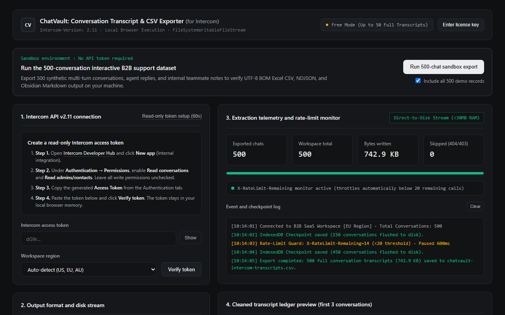

# ChatVault: Intercom Conversation Transcript & CSV Exporter (API v2.11 Guide & Local Workstation)

> **Disclaimer:** Independent third-party utility and technical reference. Not affiliated with, endorsed, or sponsored by Intercom, Inc.

Intercom's dashboard CSV export outputs ticket metadata columns (conversation ID, timestamps, assignee, tag names, SLA timers) without customer messages, agent replies, or internal teammate notes.

This repository documents the **Intercom REST API v2.11 N+1 cursor pagination model**, the **10-second rate-limit header protocol**, **sample exports (Excel UTF-8 BOM CSV, Detailed CSV, NDJSON, Obsidian Markdown)** in [`/samples`](./samples), and links to the **100% local browser workstation**.

- **Live Web Workstation & 500-Chat Interactive Sandbox (No Token Required):** https://chatvault-exporter.pages.dev/workstation
- **Browser data flow and permissions factsheet:** https://chatvault-exporter.pages.dev/security-factsheet
- **Full Technical Article:** https://chatvault-exporter.pages.dev/guide-missing-message-text
- **Chrome Web Store Extension:** https://chromewebstore.google.com/detail/ejjialbdkhkphnlappeoiblihcmpkhmd
- **Privacy Policy (Zero-Server Architecture):** https://chatvault-exporter.pages.dev/privacy
- **B2B One-Time Licensing ($29 Basic / $79 Pro / $149 Agency):** https://ydwizzle.gumroad.com/l/intercom-exporter


[](https://chatvault-exporter.pages.dev/workstation)

---

## Before using live data

- The 500-conversation sandbox uses synthetic data. The free extension export of up to 50 conversations checks access and output on your workspace.
- The browser sends the read-only token directly to Intercom. Gumroad license verification is a separate request. Review the security factsheet and your organization's extension policy before using customer data.
- This is a file export. For direct help-desk imports, use the destination's importer or a migration service. Review skipped records, CSV truncation markers and the per-conversation part limit before treating an export as complete.

## 1. Why the List Endpoint Omits Conversation Threads (`N+1` Architecture)

In Intercom REST API `v2.11`, `GET /conversations?per_page=150` returns summary records that include only the opening `source.body`. Subsequent customer replies, teammate responses, and internal notes live inside `conversation_parts.conversation_parts` (up to **500 parts per ticket**), requiring a detail request per conversation ID:

```http
# Step A: Paginate conversation summaries using starting_after cursor
GET https://api.intercom.io/conversations?per_page=150&starting_after={cursor}
Authorization: Bearer <READ_ONLY_TOKEN>
Intercom-Version: 2.11
Accept: application/json

# Step B: Fetch full transcript and internal notes per conversation ID
GET https://api.intercom.io/conversations/{conversation_id}?display_as=html
Authorization: Bearer <READ_ONLY_TOKEN>
Intercom-Version: 2.11
```

### Regional API Gateways (US, EU, AU)
- **US:** `https://api.intercom.io`
- **EU:** `https://api.eu.intercom.io`
- **AU:** `https://api.au.intercom.io`

---

## 2. Rate-Limit Control & Failure Modes at 10,000+ Tickets

- **Header-driven throttling:** Inspect `X-RateLimit-Remaining` on every response. When it drops below `20`, pause until `X-RateLimit-Reset` (UNIX epoch seconds).
- **HTTP 429 recovery:** Honor `Retry-After` seconds with exponential backoff.
- **Fault-tolerant 404/403 skipping:** Log deleted (`404`) or restricted (`403`) conversations in `skipped_errors` instead of aborting the batch.
- **Browser OOM defense:** Native disk streaming writes batches of 50 conversations. Blob downloads and ZIP bundling buffer data in memory. Checkpoints track progress, while resume produces a separate output file. After a crash or tab closure, restart the date range unless you can verify the earlier file was saved.
- **Excel 32,767-char cell overflow & UTF-8 BOM:** Strip HTML tags (`<p>`, `<br>`, `<a>`, `<li>`), truncate single cells at `32,000` characters, escape per RFC 4180, and prefix UTF-8 BOM (`\uFEFF`) so multi-language text opens cleanly in Microsoft Excel.

---

## 3. Sample Output Files

- [`samples/sample-intercom-25-chats-summary.csv`](./samples/sample-intercom-25-chats-summary.csv) — 1 row per conversation (`full_transcript` + dedicated `internal_notes_transcript` column)
- [`samples/sample-intercom-10-chats-detailed-parts.csv`](./samples/sample-intercom-10-chats-detailed-parts.csv) — 1 row per message part, reply, or internal note
- [`samples/sample-intercom-10-chats.jsonl`](./samples/sample-intercom-10-chats.jsonl) — Structured NDJSON with both raw HTML and cleaned plain text
- [`samples/sample-intercom-10-chats-obsidian-rag.md`](./samples/sample-intercom-10-chats-obsidian-rag.md) — Obsidian / RAG Markdown with YAML frontmatter

---

## 4. Local Unit & Integration Tests

```bash
node --test tests/chatvault.test.mjs
```

Optional pattern masking covers common email, phone and card-number patterns across exports. Masked exports omit attachments. Review the output before sharing because identifying information can remain.

After an export, use **Download export audit** for per-file counts and an optional SHA-256 of the transcript. ZIPs include the audit. The browser hashes readable transcripts up to 32 MiB.

The automated suite covers HTML sanitization, UTF-8 BOM, 32,000-character cell guards, US/EU/AU auto-detection, cursor pagination, HTTP 429 backoff, 404/403 skipping, Gumroad 4-fold license verification + 5xx outage grace extension, and IndexedDB checkpoint save/resume integrity.
